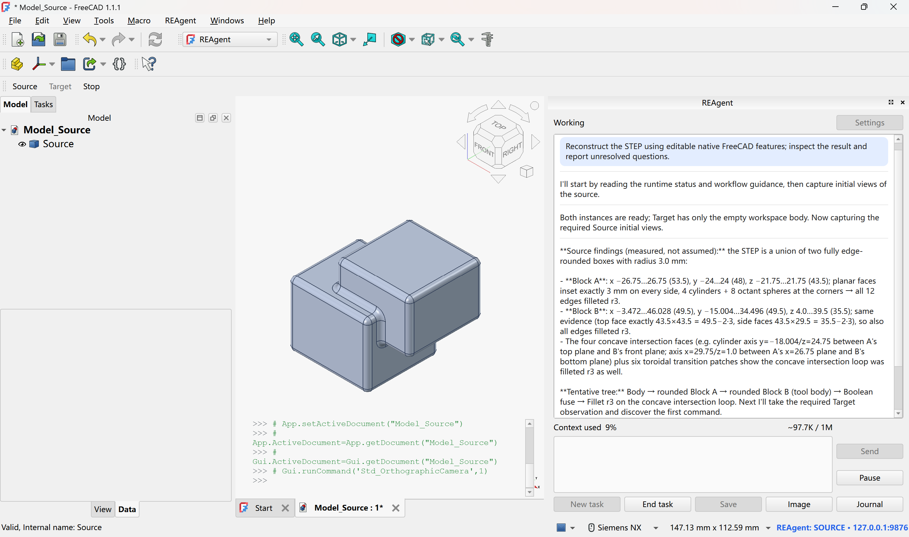
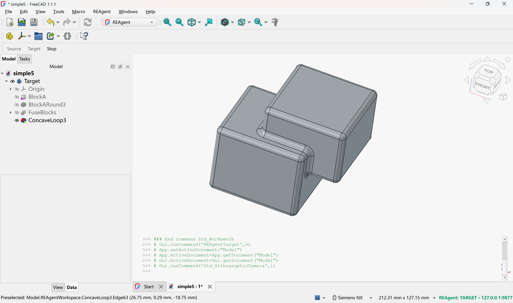
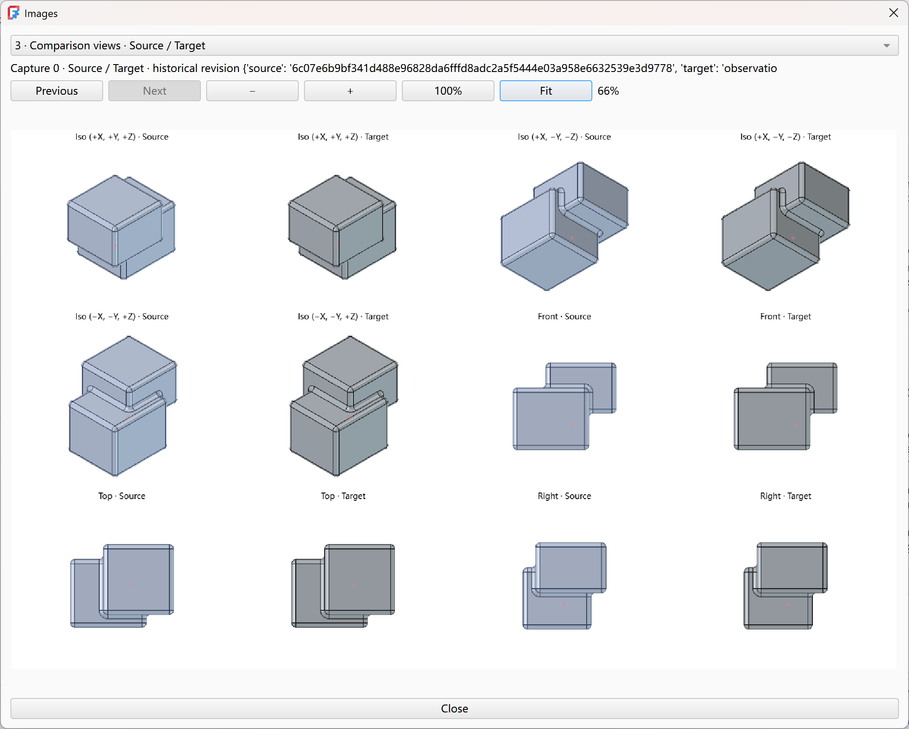

# REAgentFreeCAD

English | [简体中文](docs/README.zh-CN.md)

**Reconstruct editable FreeCAD parts with an agent from STP, STL, engineering drawings, images, or text.**

**REAgent** is an AI assistant running inside FreeCAD. It reads the selected input and progressively builds a native feature history in a separate Target window.

## Features

- **/stp2cad** Reconstruct an STP file containing a single solid as a parametric model.
- **/stl2cad** Reconstruct an STL mesh representing a single solid as a parametric model.
- **/drawing2cad** Build a model from a fully dimensioned DXF engineering drawing.
- **/image2cad** Reconstruct a part from reference images such as photos, screenshots, or hand-drawn sketches.
- **/text2cad** Build a model from a text description of the required shape, dimensions, and features.

The images below show the source model, the reconstructed feature tree and comparisons from multiple views for an STP reconstruction.

<p align="center">
  <a href="docs/source.png"></a><br>
</p>

<p align="center">
  <a href="docs/result.png"></a><br>
</p>

<p align="center">
  <a href="docs/comparison.png"></a><br>
</p>

## Installation and configuration

Requires **FreeCAD 1.1 or later** and uses its bundled Python (3.10+) and Qt environment.

Close FreeCAD, then copy the repository's `addon/REAgent/` folder into the `Mod` folder in your FreeCAD installation directory.

The following example uses `C:\Program Files\FreeCAD 1.1`; adjust it to your installation path. Run the PowerShell command from the repository root. Writing to `Program Files` may require administrator privileges:

```powershell
Copy-Item -LiteralPath '.\addon\REAgent' -Destination 'C:\Program Files\FreeCAD 1.1\Mod' -Recurse -Force
```

After installation, `<FreeCAD installation directory>/Mod/REAgent/InitGui.py` should exist.

## Quick start

1. **Bind the windows:** Start two separate, visible FreeCAD processes and switch both to the REAgent workbench. Click **Source** in one and **Target** in the other. Source opens the assistant panel and inspects the source model; Target reconstructs the model.
2. **Configure the model:** In the Source panel, open **Settings** and choose a provider such as **Anthropic**, **OpenAI**, or **DeepSeek**. Fill in **Model** and **API key**, then save. Set reasoning effort, context capacity, and output budget to match the model's capabilities. For reconstruction, the service must support streaming responses, tool calls, and image input through the corresponding protocol.
3. **Start reconstruction.** In the Source panel, click **New task**, type `/`, select a command, then click **Send**. In the dialog, provide the task input, choose an output folder, and add any instructions. Click **Start**.
4. **Observe and adjust:** Follow progress in the conversation. Open **Image** to browse the captured views and **Journal** to review the operation log. Use regular chat messages to request changes to the model.
5. **Save the result:** In the Target window, inspect the feature tree and check that feature parameters are editable. In the Source panel, click **Save**. Confirm that the save succeeded, then click **End task**.

## System architecture

The complete Addon lives in `addon/REAgent/`. `InitGui.py` registers the workbench and binds each FreeCAD process as Source or Target. Both roles run a local Bridge on the GUI thread.

```text
Source panel (GUI thread)
    |
    v
Source worker: application/ -> agent/ <-> model/ <-> Model service
                               |
                               v
                               cad/
                               |
                               +-- Local Bridge --> Source host/ (GUI thread)
                               |                    Read-only observation
                               |
                               +-- Local Bridge --> Target host/ (GUI thread)
                                                    Native modeling
```

## License

[MIT License](LICENSE). The complete Addon includes the same [license](addon/REAgent/LICENSE).
