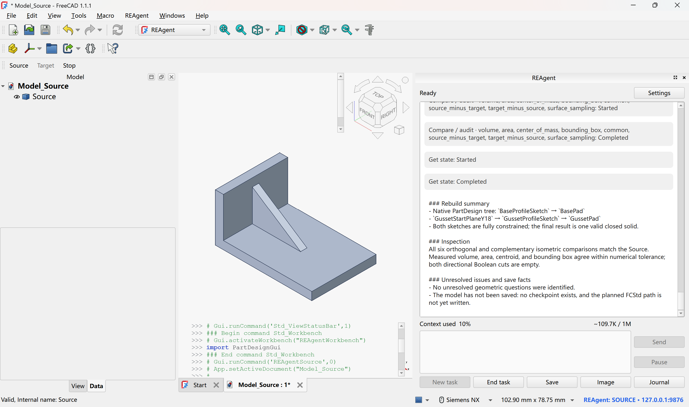
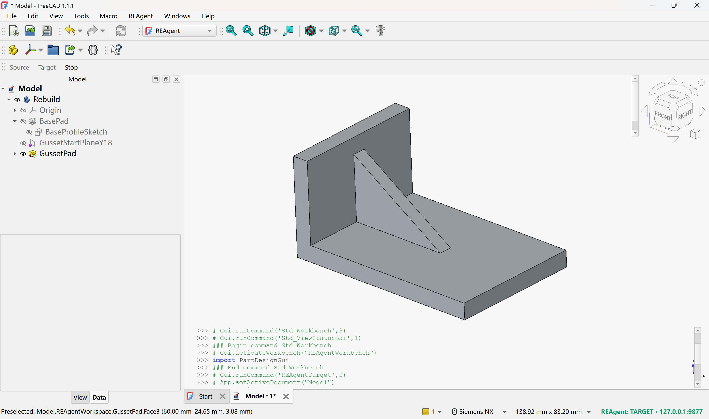
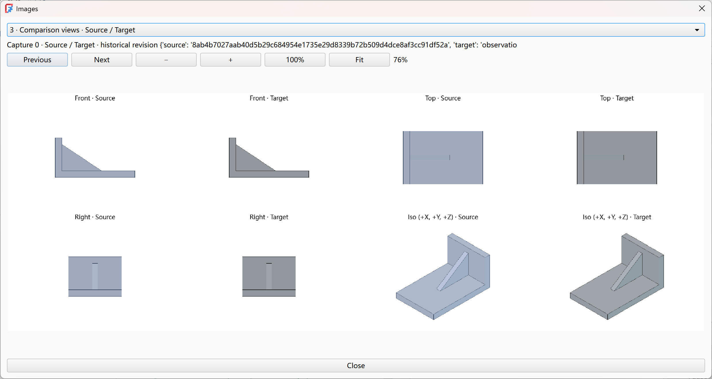

# REAgentFreeCAD

English | [简体中文](docs/README.zh-CN.md)

**Reconstruct STEP parts as editable FreeCAD models with an agent.**

**REAgent** is an AI assistant running inside FreeCAD. It inspects the source part, chooses modeling operations, reads execution results and progressively builds a native feature history in a separate Target window.

The images below show the source model, the reconstructed feature tree and comparisons from multiple views.

<p align="center">
  <a href="docs/source.png"></a><br>
</p>

<p align="center">
  <a href="docs/result.png"></a><br>
</p>

<p align="center">
  <a href="docs/comparison.png"></a><br>
</p>

## Installation and configuration

Requires **FreeCAD 1.1 or later** and uses its bundled Python (3.10+) and Qt environment.

Close FreeCAD, then copy the repository's `addon/REAgent/` folder into the `Mod` folder in your FreeCAD installation directory.

The following example uses `C:\Program Files\FreeCAD 1.1`; adjust it to your installation path. Run the PowerShell command from the repository root. Writing to `Program Files` may require administrator privileges:

```powershell
Copy-Item -LiteralPath '.\addon\REAgent' -Destination 'C:\Program Files\FreeCAD 1.1\Mod' -Recurse -Force
```

After installation, `<FreeCAD installation directory>/Mod/REAgent/InitGui.py` should exist.

## Quick start

1. **Bind the windows:** Start two separate, visible FreeCAD processes and switch both to the REAgent workbench. Click **Source** in one and **Target** in the other. Source opens the assistant panel and inspects the source model; Target reconstructs the model.
2. **Configure the model:** Open **Settings** in the Source panel, choose **Anthropic**, **OpenAI** or **DeepSeek**, enter the **Model** and **API key**, then save. Set reasoning effort, context capacity and output budget according to the model's actual capabilities. The service used for reconstruction must support streaming responses, tool calls and image input through the corresponding protocol.
3. **Start reconstruction:** Click **New task**, enter **/rebuild**, select a single-solid STEP/STP file and an output folder, then click **Start**. You can describe your requirements in ordinary messages first; ordinary messages do not create CAD models or call CAD tools by themselves.
4. **Observe and adjust:** Follow progress in the conversation, browse observation images through **Image** and view the operation log through **Journal**.
5. **Save the result:** Inspect the feature tree and check parameter editability in the Target process, then click **End task** to end the assistant task when finished.

Enter **/** in the conversation input to view commands. **/status** shows task and context status; **/compact** compacts the conversation context.

## System architecture

The entire product is located in `addon/REAgent/`. `bootstrap.py` is the composition root: Source assembles the task panel, background worker and application session; Target assembles the host Bridge and native CAD operation entry points.

```text
Source window / GUI main thread
  ui/: panel, settings, user actions and status display
   |
   v
Source background worker (single)
  session/ --> agent/ <--> model/ <--> Model service
                 |
                 | Tool calls / execution results
                 v
              rebuild/
                 |
                 +-- Local Bridge --> Source host/: read-only observation
                 |                    Runs on the Source GUI main thread
                 |
                 +-- Local Bridge --> Target host/: native modeling and readback
                                      Runs on the Target GUI main thread
                                        |
                                        +--> FCStd (explicit Save)
```

| Module | Responsibility |
| --- | --- |
| `ui/` | The panel, model settings, image and log windows. `SourceWindowController` coordinates user actions, window closing and the worker lifecycle. |
| `session/` | Uses `Session` to coordinate switching between ordinary chat and reconstruction, user actions and application state snapshots. |
| `agent/` | Uses `Run` to own the active conversation context and organize the model/tool loop, pausing and compaction. `ModelRequests` manages how request results are recorded and incorporated. |
| `model/` | Adapts Anthropic, OpenAI and DeepSeek, handling model configuration, streaming transport, message encoding and capacity estimation. |
| `rebuild/` | `RebuildTools` provides reconstruction tools and modeling knowledge. `Controller` coordinates command discovery, evidence registration, revision guards, calls to both roles and the Journal. |
| `host/` | Handles observation, native features, transactions, recomputation, result readback, recovery and saving within FreeCAD. `ProcessState` maintains each process's native task state. |
| `protocol/` | Defines the shared contracts for operations, parameters, roles, geometry references, observations and artifacts used by both reconstruction control and host execution. |

`values.py` and `schema.py` provide basic JSON handling and validation; `knowledge/` ships modeling rules and knowledge cards with the Addon.

## License

[MIT License](LICENSE). The complete Addon includes the same [license](addon/REAgent/LICENSE).
