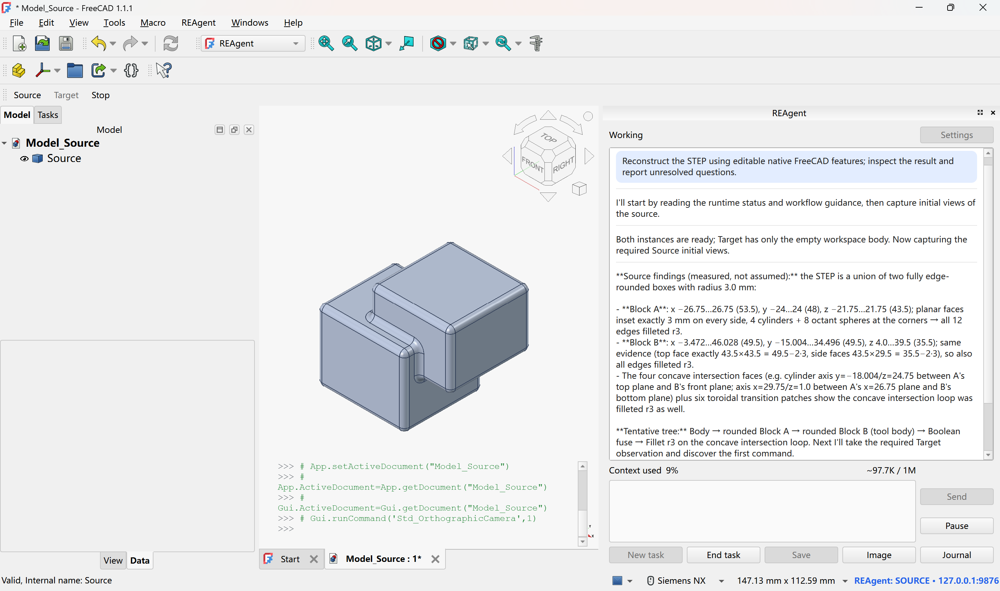
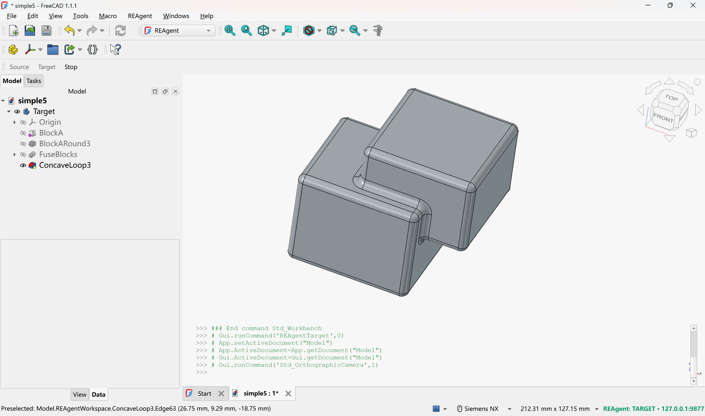
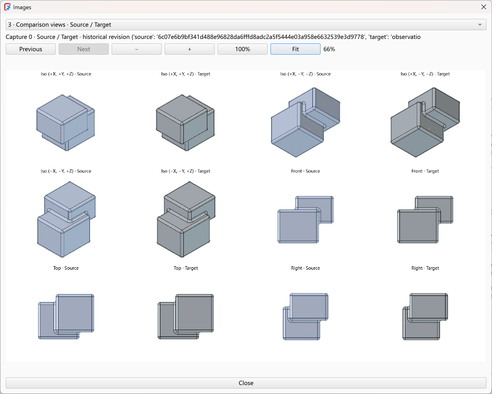

# REAgentFreeCAD

[English](../README.md) | 简体中文

**让 Agent 从 STP、STL、工程图、图片或文字需求中重建可编辑的 FreeCAD 零件。**

**REAgent** 是运行在 FreeCAD 内的 AI 助手：读取选定的输入，并在独立的 Target 窗口中逐步建立原生特征历史。

## 功能特性

- **/stp2cad：** 将含单个实体的 STP 文件重建为参数化模型。
- **/stl2cad：** 将含单个实体的 STL 网格重建为参数化模型。
- **/drawing2cad：** 根据标注完整的 DXF 工程图建模。
- **/image2cad：** 从照片、截图或手绘等参考图片重建零件。
- **/text2cad：** 按文字描述中的形状、尺寸和特征要求建模。

下图展示 STP 重建的源模型、特征树与多视角对照。

<p align="center">
  <a href="source.png"></a><br>
</p>

<p align="center">
  <a href="result.png"></a><br>
</p>

<p align="center">
  <a href="comparison.png"></a><br>
</p>

## 安装与配置

需要 **FreeCAD 1.1 或更新版本**，使用 FreeCAD 自带的 Python（3.10+）和 Qt 环境。

关闭 FreeCAD，将仓库中的 `addon/REAgent/` 文件夹复制到 FreeCAD 安装目录的 `Mod` 文件夹。

以下以 `C:\Program Files\FreeCAD 1.1` 为例，请按实际安装路径调整。在仓库根目录执行 PowerShell 命令；写入 `Program Files` 可能需要管理员权限：

```powershell
Copy-Item -LiteralPath '.\addon\REAgent' -Destination 'C:\Program Files\FreeCAD 1.1\Mod' -Recurse -Force
```

安装后应存在 `<FreeCAD 安装目录>/Mod/REAgent/InitGui.py`。

## 快速开始

1. **绑定窗口：** 启动两个独立、可见的 FreeCAD 进程，均切换到 REAgent 工作台，再分别点击 **Source** 和 **Target**。Source 打开助手面板并观察源模型，Target 负责重建模型。
2. **配置模型：** 在 Source 面板打开 **Settings**，选择 **Anthropic、OpenAI 或 DeepSeek**等，填写 **Model** 与 **API key** 并保存。根据模型的实际能力设置推理强度、上下文容量和输出预算。重建所用服务须支持对应协议的流式响应、工具调用与图像输入。
3. **开始重建：** 在 Source 面板点击 **New task**，输入 `/` 选中命令后点击 **Send**，在弹出的对话框选择输入文件、输出目录和补充信息，点击 **Start** 开始重建。
4. **观察与调整：** 在对话区查看进展，通过 **Image** 浏览观察图片，通过 **Journal** 查看操作日志。可以在对话框发送普通消息来调整模型。
5. **保存结果：** 在 Target 进程中检查特征树与参数编辑，在 Source 面板点击 **Save**，确认保存成功后点击 **End task**。

## 系统架构

完整 Addon 位于 `addon/REAgent/`。`InitGui.py` 注册工作台，将各 FreeCAD 进程绑定为 Source 或 Target，两端都在 GUI 主线程运行本机 Bridge。

```text
Source 面板（GUI 主线程）
    |
    v
Source worker: application/ -> agent/ <-> model/ <-> 模型服务
                               |
                               v
                               cad/
                               |
                               +-- 本机 Bridge --> Source host/（GUI 主线程）
                               |                 只读观察
                               |
                               +-- 本机 Bridge --> Target host/（GUI 主线程）
                                                 原生建模
```

## 许可证

[MIT License](../LICENSE)，完整 Addon 内附有同一份[许可证](../addon/REAgent/LICENSE)。
