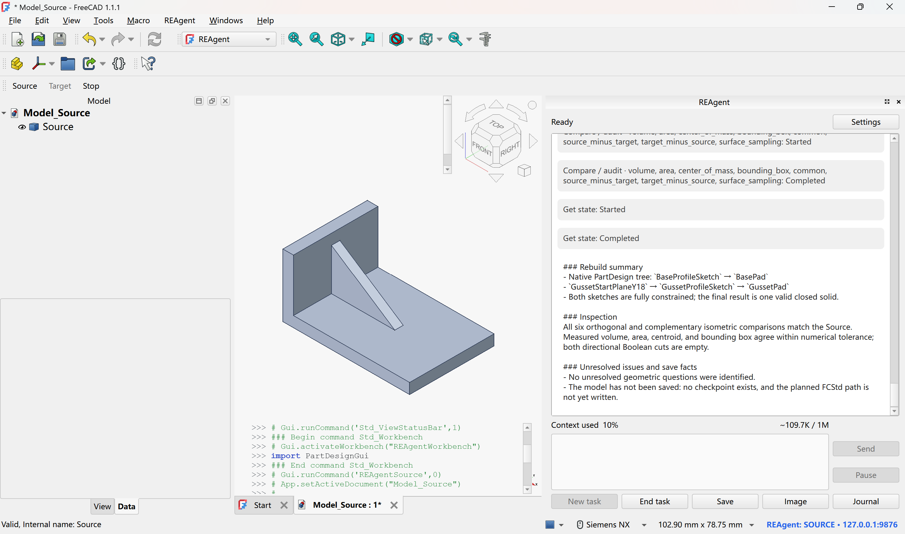
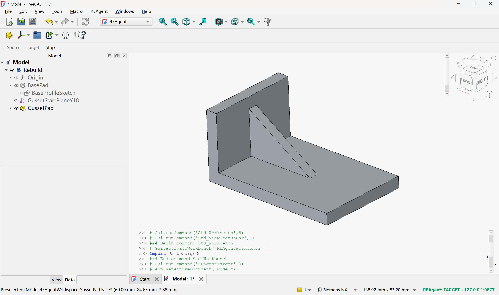
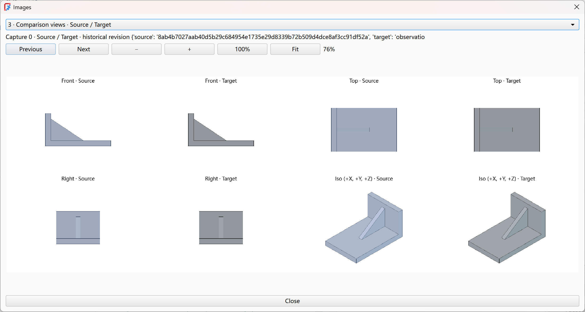

# REAgentFreeCAD

[English](../README.md) | 简体中文

**让 Agent 把 STEP 零件重建为可编辑的 FreeCAD 模型。**

**REAgent** 是运行在 FreeCAD 内的 AI 助手：观察源零件、选择建模操作、读取执行结果，并在独立的 Target 窗口中逐步建立原生特征历史。

下图展示源模型、重建特征树与多视角对照。

<p align="center">
  <a href="source.png"></a><br>
</p>

<p align="center">
  <a href="result.png"></a><br>
</p>

<p align="center">
  <a href="comparison.png"></a><br>
</p>

## 安装与配置

需要 **FreeCAD 1.1 或更新版本**，使用 FreeCAD 自带的 Python（3.10+）和 Qt 环境。

关闭 FreeCAD，将仓库中的 `addon/REAgent/` 文件夹复制到 FreeCAD 安装目录的 `Mod` 文件夹。

以下以 `C:\Program Files\FreeCAD 1.1` 为例，请按实际安装路径调整。在仓库根目录执行 PowerShell 命令；写入 `Program Files` 可能需要管理员权限：

```powershell
Copy-Item -LiteralPath '.\addon\REAgent' -Destination 'C:\Program Files\FreeCAD 1.1\Mod' -Recurse -Force
```

安装后应存在 `<FreeCAD 安装目录>/Mod/REAgent/InitGui.py`。

## 快速开始

1. **绑定窗口：** 启动两个独立、可见的 FreeCAD 进程，均切换到 REAgent 工作台，再分别点击 **Source** 和 **Target**。Source 打开助手面板并观察源模型，Target 负责重建模型。
2. **配置模型：** 在 Source 面板打开 **Settings**，选择 **Anthropic、OpenAI 或 DeepSeek**，填写 **Model** 与 **API key** 并保存。根据模型的实际能力设置推理强度、上下文容量和输出预算。重建所用服务须支持对应协议的流式响应、工具调用与图像输入。
3. **开始重建：** 点击 **New task**，输入 **/rebuild**，选择单实体 STEP/STP 文件与输出目录，再点击 **Start**。可先通过普通消息说明要求；普通消息本身不创建 CAD 模型或调用 CAD 工具。
4. **观察与调整：** 在对话区查看进展，通过 **Image** 浏览观察图片，通过 **Journal** 查看操作日志。
5. **保存结果：** 在 Target 进程中检查特征树与参数编辑，完成后点击 **End task** 结束助手任务。

在对话框中输入 **/** 可查看命令；**/status** 用于查看任务与上下文状态，**/compact** 用于压缩对话上下文。

## 系统架构

整个产品位于 `addon/REAgent/`。`bootstrap.py` 是最终入口：Source 组装任务面板、后台 worker 与应用会话；Target 组装宿主 Bridge 和原生 CAD 操作入口。

```text
Source 窗口 / GUI 主线程
  ui/：面板、设置、用户操作与状态呈现
   |
   v
Source 后台 worker（唯一）
  session/ --> agent/ <--> model/ <--> 模型服务
                 |
                 | 工具调用 / 执行结果
                 v
              rebuild/
                 |
                 +-- 本机 Bridge --> Source host/：只读观察
                 |                   在 Source GUI 主线程执行
                 |
                 +-- 本机 Bridge --> Target host/：原生建模与读回
                                     在 Target GUI 主线程执行
                                       |
                                       +--> FCStd（显式 Save）
```

| 模块 | 职责 |
| --- | --- |
| `ui/` | 面板、模型设置、图片与日志窗口；`SourceWindowController` 协调用户操作、窗口关闭与 worker 生命周期。 |
| `session/` | 通过 `Session` 协调普通聊天与重建之间的切换、用户动作和应用状态快照。 |
| `agent/` | 通过 `Run` 持有活动对话上下文，组织模型与工具循环、暂停和压缩；`ModelRequests` 管理请求结果的记录与采用。 |
| `model/` | 适配 Anthropic、OpenAI、DeepSeek，处理模型配置、流式传输、消息编码与容量估算。 |
| `rebuild/` | `RebuildTools` 提供重建工具与建模知识，`Controller` 协调命令发现、证据登记、修订守卫、两端调用和 Journal。 |
| `host/` | 在 FreeCAD 内处理观察、原生特征、事务、重算、结果读回、恢复与保存；`ProcessState` 保存各进程的原生任务状态。 |
| `protocol/` | 定义两端共用的操作、参数、角色、几何引用、观察与产物契约，供重建控制与宿主执行共同使用。 |

`values.py` 与 `schema.py` 提供基础 JSON 处理与校验能力；`knowledge/` 随 Addon 提供建模规则与知识卡片。

## 许可证

[MIT License](../LICENSE)，完整 Addon 内附有同一份[许可证](../addon/REAgent/LICENSE)。
